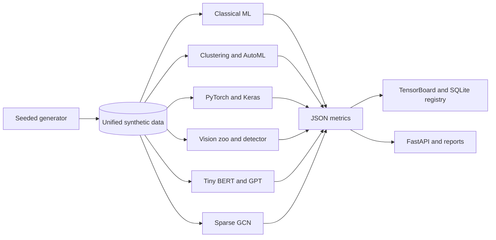

# AI Rookie Skill Tree Lab

[](https://github.com/chelsietao/ai-rookie-skill-tree-lab/actions/workflows/lint-test.yml)
[](https://github.com/chelsietao/ai-rookie-skill-tree-lab/actions/workflows/mysql-smoke.yml)

A CPU-first, fully local learning repository that turns the SinoPac Turing Plan **AI rookie**
skill tree into executable evidence. It audits all 114 active rank-1/rank-2 nodes—84 AI and 30
software-engineering nodes—while retaining official hierarchy, capitalization variants, and
duplicate-case entries.

This is not a keyword checklist or a set of launcher notebooks. Every chapter includes mechanism,
implementation, configuration, tests, measured results, figures/artifacts, limitations, and
extensions. All experiments share one seeded fictional retail world.

## Learning notebooks

The repository contains 13 executable, Colab-compatible chapters. The seven modeling chapters have
22–28 cells each; the six system chapters have 15 cells each. Notebook JSON is generated from
reviewable Python source and CI checks that committed notebooks are not stale.

| Route | Chapters |
|---|---|
| Orientation | 00 evidence, environments, profiles, reproducibility |
| Modeling | 01 data, 02 classical ML, 03 unsupervised/AutoML, 04 deep learning, 05 vision, 06 NLP, 07 GNN |
| Systems | 08 tracking/SQL, 09 API/CLI/serialization, 10 testing/CI/security, 11 reproducibility audit |
| Career defense | 12 official skill matrix, résumé claims, negative-result interview practice |

## What is implemented

| Lab | Evidence |
|---|---|
| Data and software | NumPy, Pandas, missing-value imputation, scaling, imbalance, JSON/YAML, logging, Git/GitHub/GitLab, SQLite/MySQL/MSSQL |
| Classical ML | KNN, linear/logistic, Lasso/Ridge, SVC/SVR, decision tree, Random Forest, Extra-Trees, XGBoost, CatBoost, MLP |
| Unsupervised and AutoML | K-Means, DBSCAN, agglomerative clustering, PCA, t-SNE, UMAP, grid/random/Optuna TPE search |
| Deep learning | PyTorch and TensorFlow/Keras MLP, autoencoder, RNN, LSTM, GRU, activation/init/norm/scheduler ablations |
| Computer vision | Tiny CNN, VGG, ResNet, MobileNet, EfficientNet, SqueezeNet, ViT, pooling, augmentation, object detection |
| NLP | TF-IDF, NLU/intent, sentiment, local Tiny BERT MLM pre-training/fine-tuning, local Tiny GPT generation |
| Graph ML | Manual sparse PyTorch GCN, node classification, joint link-reconstruction loss |
| Tracking and serving | TensorBoard events, SQLite experiment registry, CLI, FastAPI, CI and reproducibility report |

See the row-by-row [official skill matrix](docs/official-skill-matrix.md), the
[GitHub gap analysis](docs/github-gap-analysis.md), and the [research report](reports/research-report.md).

## Synthetic portfolio data

The full profile generates:

- 20,000 fictional customers
- 100,000 transactions
- 50,000 product-view events
- 10,000 transaction sequences
- 5,000 support texts
- 5,000 generated product images and bounding boxes
- 148,923 distinct customer-product edges

No record comes from a real person or company. The seed is `20260820`; missingness, imbalance,
temporal signal, image geometry, and anomaly labels are deliberately designed. See the
[data card](docs/data-card.md).

## Portfolio results

These are results from the full local profile, not the smaller CI smoke profile.

| Experiment | Result |
|---|---:|
| Best churn classifier, CatBoost | ROC-AUC 0.8035 |
| Logistic 3-fold cross-validation | mean ROC-AUC 0.7779 |
| Best spend regressor, Lasso | R² 0.4203 |
| PyTorch RNN / LSTM / GRU | ROC-AUC 0.9966 / 0.9963 / 0.9964 |
| TensorFlow/Keras tabular MLP / GRU | ROC-AUC 0.8033 / 0.9825 |
| Autoencoder anomaly detection | ROC-AUC 0.9578 |
| Seven tiny vision architectures | 1.000 synthetic-shape accuracy |
| Object detector | mean IoU 0.8248; mAP@.50:.95 0.7988 |
| Tiny BERT sentiment | ROC-AUC 1.000 |
| Tiny GPT | perplexity 2.7528 |
| GCN node / logistic+degree baseline | ROC-AUC 0.7001 / 0.8004 |
| GCN link / degree-popularity baseline | ROC-AUC 0.5553 / 0.5913 |

The perfect vision/NLP values reflect intentionally simple synthetic labels, not real-world
generalization. Both graph tasks lose to traditional baselines in the full run; that negative
result is retained and discussed instead of being hidden.

## Architecture



## Run locally

Python 3.11 or 3.12 is required. No API key is used.

```bash
python3 -m venv .venv
source .venv/bin/activate
python -m pip install -e '.[full,dev]'
python scripts/reproduce_all.py --profile ci
```

Run the full portfolio profile:

```bash
python scripts/reproduce_all.py --profile portfolio
```

Run the API:

```bash
ROOKIE_LAB_DATA_DIR=data/generated/portfolio rookie-lab serve
```

Then open `http://127.0.0.1:8000/docs`.

## VS Code

Open the repository folder, select `.venv/bin/python`, and use **Terminal → Run Task**.
The committed `.vscode/tasks.json` includes data generation, CI reproduction, tests, and API tasks.
The `dev` extra installs an IPython kernel plus notebook execution tools. Notebooks teach and inspect;
tested reusable implementation remains in `src/rookie_lab`. A notebook-first history is maintained
on the `codex/colab-notebook-first` branch.

### Notebook-first branch

Start with `notebooks/00_start_here.ipynb`, then run the numbered chapters in order. The branch
contains 13 validated notebooks covering setup, data, classical ML, unsupervised learning and
AutoML, deep learning, vision, NLP, graphs, tracking and SQL, FastAPI, testing and security, full
reproduction, and the official skill matrix.

The `.py`, `.yaml`, `.sql`, and workflow files intentionally remain in the branch: Colab notebooks
call the tested package code, while those native files preserve imports, CI, database schemas, and
reproducibility. The primary learning and editing path is entirely notebook-based.

## Release map

- v0.1 Foundations and Data
- v0.2 Classical Supervised Learning
- v0.3 Unsupervised and AutoML
- v0.4 Deep Learning Fundamentals
- v0.5 Computer Vision Architecture Zoo
- v0.6 NLP and Transformers
- v0.7 Graph Neural Networks
- v0.8 Tracking, RDBMS, and Framework Integration
- v1.0 Reproducible Portfolio System
- v1.1 Deep Evidence Edition: larger data, richer metrics, 13 substantial notebooks, negative baselines

## Responsible use

This repository is educational. Models must not be used for real credit, insurance, employment,
health, fraud, or financial decisions. See [limitations](reports/limitations.md) and
[security](SECURITY.md).

## Attribution

The skill-name snapshot is derived from the publicly accessible SinoPac Turing Plan skill tree,
inspected on 2026-08-20. This independent educational repository is not affiliated with or
endorsed by SinoPac. Code is MIT licensed; third-party product names remain their owners' marks.
